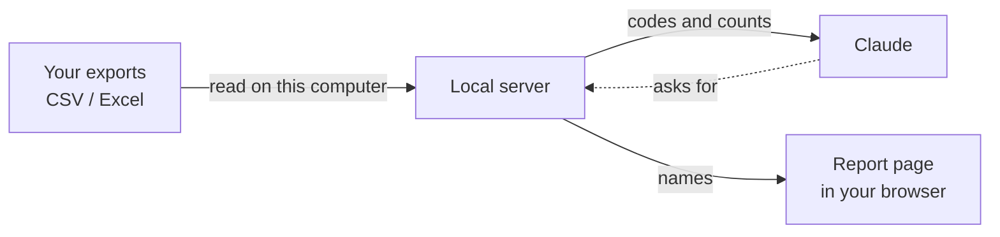

# Mindbody Attendance Trends

Find the regulars whose attendance is slipping, from Mindbody report exports, on your own computer.

This is an unofficial tool. It is not made by, affiliated with, or endorsed by Mindbody. "Mindbody" is used only
to say which reports it reads.

## What it does

Many facility owners do not have Mindbody API access, but they can export reports. This tool reads those exports
and gives you a short list: people who used to come in most weeks and have recently dropped off. You can use the
list to decide who gets a friendly check-in.

It reads:

- **Attendance without Revenue** (required): the last 3 months, as CSV or Excel. One file or several monthly
  files. Overlapping files are fine; repeated visits are removed.
- **Autopay Detail**, filtered to Suspended (optional): people on hold are left out.
- **Membership (New Version)** (optional): only active members are kept.

It runs as a small local server that Claude can call. You can install it two ways from this one codebase:

- a **Claude Desktop extension** (`.mcpb` file), or
- a **Claude Code plugin**, which adds a skill that walks through the steps and a hook that keeps Claude's own
  file tools away from your exports.

## Privacy model



- **Your files stay on your computer.** The server reads them on your machine. It does not upload them, and the
  report page makes no network requests (it is one HTML file with everything inside it).
- **By default, Claude sees member codes and counts, not names.** A tool result looks like `M-0147: usual 3.0 a
  week, last 3 weeks 0.7, last visit Sep 28`. Codes are assigned in a random order each session, so a code says
  nothing about who the person is. Client IDs are not sent either.
- **Names appear only in the report page**, which `open_report` saves in a local folder and opens in your
  default browser.
- **If columns are unclear**, the tool shows Claude the header names (for example "Class Date", "Service Date")
  so you can pick one. It never shows row values.

### The opt-in: `share_names_with_claude`

This setting is off by default. If you turn it on, the `slipping_regulars` tool also returns names, so you can
ask Claude things like "draft a note to the first three". The trade-off:

- **Off:** Claude cannot connect a code to a person. Anything you send to Claude stays free of member names,
  unless you type them in yourself. You read names in the browser page.
- **On:** names are part of your chat, so they are sent to Anthropic along with the rest of the conversation and
  handled under your Claude account's data terms. That is more convenient, and it is your call whether it fits
  your privacy obligations to your members.

Either way, nothing is sent to members. The tool does not email, text, or message anyone.

### What the Claude Code hook does, and does not do

In Claude Code, the plugin adds a `PreToolUse` hook. It blocks Claude's Read, Grep, and Bash tools from opening
files you loaded with `load_exports`, anything in the plugin's data folder (where reports are saved), and
wildcard reads such as `cat *.csv` in a folder that holds a loaded export.

It is a guard rail, not a sandbox. It matches paths and file names in tool calls. A determined workaround (for
example, a script that builds the path at run time, or a symlink) could get past it. Claude Desktop has no hook,
but it also has no general file-reading tool unless you added one.

## How to export the reports from Mindbody

Report names and menus can differ by Mindbody version.

**Attendance without Revenue**

1. Go to **Insights > Reports** and search for **Attendance without Revenue**.
2. Set the date range to the **last 3 months**.
3. Include **all service categories**.
4. Click **Generate**, then **Export** to Excel or CSV.
5. If it times out, run **three monthly exports** instead (for example, July, August, September). Load all three
   together. Small overlaps between them are fine.

**Autopay Detail (optional, for holds):** run Autopay Detail, filter the status to **Suspended**, and export.

**Membership (New Version) (optional):** run the membership report and export. If it has a status column, only
rows marked Active count as active.

Excel files must be `.xlsx`. If you get an older `.xls` file, open it and save it as `.xlsx` or `.csv`.

## Install

You need Node.js 20 or later to build. Claude Desktop includes its own Node.js to run the extension.

```sh
npm ci
npm test
npm run build          # writes dist/server.js and dist/guard.js
```

### Claude Desktop

```sh
npm run pack:mcpb      # writes dist/mindbody-attendance-trends.mcpb
```

Open the `.mcpb` file (double-click it, or drag it into Claude Desktop's Settings > Extensions). Leave **Share
member names with Claude** off unless you have decided you want it on.

### Claude Code

After `npm run build`, add this folder as a local plugin marketplace and install from it:

```sh
claude plugin marketplace add /path/to/mindbody-attendance-trends
claude plugin install mindbody-attendance-trends@mindbody-attendance-trends
```

Or try it for one session with `claude --plugin-dir /path/to/mindbody-attendance-trends`.

Then ask something like: "Use the slipping regulars skill on the exports in my Downloads folder." Reports and the
list of loaded paths are kept in the plugin's data folder (`${CLAUDE_PLUGIN_DATA}`). Outside the plugin, the
folder is `~/.mindbody-attendance-trends`, or set `MAT_DATA_DIR`.

## Tools

| Tool | What it returns |
| --- | --- |
| `load_exports(paths, hold_paths?, membership_paths?)` | Counts only: rows read, duplicates removed, members, date range, data date, complete weeks, and per-file status. If columns are unclear, the header names to choose from. |
| `map_columns({client_name?, first_name?, last_name?, client_id?, visit_date?, visit_time?, class_name?, status?, location?})` | Sets which header holds each field and retries files that were waiting. |
| `slipping_regulars({data_date?, min_weeks_attended?, min_usual_per_week?, drop_ratio?})` | Codes with numbers: usual per week, last 3 weeks per week and each week, last visit, weeks attended of 8. Names only if sharing is on. |
| `open_report({...same options, facility_name?})` | Writes the report page with names, opens it in your browser, and returns the file path and count. |

## The rule

1. **Weeks run Monday to Sunday.** The tool looks at 12 weeks ending with the week of the **data date**. The data
   date is the latest visit date in your files, unless you give one.
2. **The data date's week counts only if the data date is a Saturday or Sunday.** Otherwise that week is not
   over, and the last 3 weeks end with the week before.
3. **Usual** is the 8 weeks just before the last 3.
4. **A regular** attended in at least **6 of those 8 weeks** and averaged **2 or more days a week**. A day counts
   once, however many classes they took. No-shows and late cancels do not count.
5. **Slipping** means the last 3 weeks averaged **60% of usual or less**, and the latest of the 3 was also **60%
   of usual or less**. The second check keeps someone who already came back from being flagged.
6. **Weeks before your files begin are unknown**, not zero. A member who would need those weeks is left out
   rather than flagged.
7. **Left out:** members on hold (Autopay Detail, Suspended), members not active in the membership export (when
   you load one), and clients whose name starts with "Test".

The thresholds (6 of 8, 2 a week, 60%) are defaults and can be changed per call.

## Limits

- **Column names vary by Mindbody version and settings.** The tool recognizes common header names. When it is
  unsure, it asks. It has been tested on synthetic files shaped like these exports, not on every real layout.
- **Dates are read in US order** (month/day/year).
- **Not validated against cancellations.** Nobody has checked that people on this list cancel more often than
  others. Treat it as a reason to say hello, not as a prediction.
- **A missing month looks like a drop.** If your monthly files leave a gap of more than a week, the tool warns
  you, but it still counts the gap as no visits.
- **"Test" means "starts with Test".** A real client whose name starts with those letters (for example, a last
  name like "Testa" in "Last, First" order) would be left out.
- **Matching holds and memberships** uses the client ID when both files have one, and otherwise the name. Two
  people with the same name and no ID column would be treated as one person.
- **Old `.xls` files are not read.** Save them as `.xlsx` or `.csv`.

## Status

Built and tested on synthetic data only. Not yet used on real exports.

## Development

```sh
npm test               # vitest
npm run typecheck
npm run build
```

Tests use made-up names and files created at test time. Never commit real exports; `.gitignore` excludes CSV and
Excel files outside `test/fixtures`.

## License

MIT. See [LICENSE](LICENSE).
